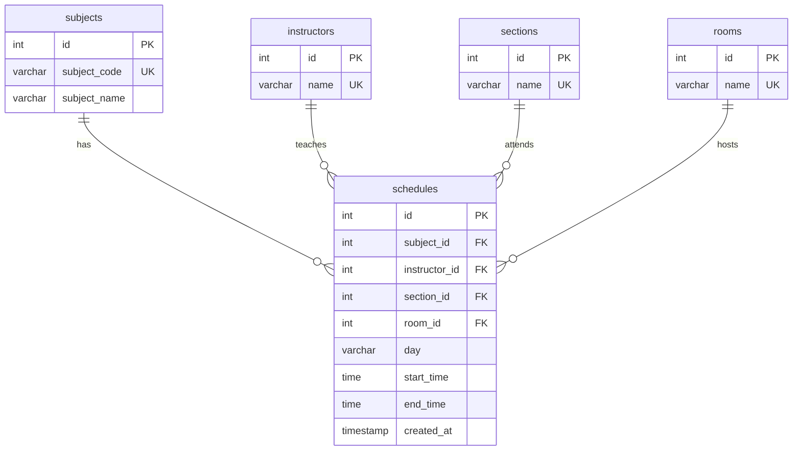

# Class Scheduling System

A web-based CRUD application for creating and managing class schedules, with automatic detection of room, instructor and section conflicts.

**Final Project:** Web Systems Technologies (PHP and MySQL Development)
**Author:** JM Jagorin
**Live System:** https://hinataa.free.je
**Hosting:** InfinityFree

## Technologies

- PHP (MySQLi, prepared statements)
- MySQL / MariaDB
- HTML5 and CSS3
- Bootstrap 5

## Features

- **Add, view, edit and delete** class schedules (full CRUD)
- **Conflict detection** that blocks double-booking of a room, instructor or section at overlapping times
- **Manage Data** page to maintain subjects, instructors, sections and rooms
- Records that are still used by a schedule cannot be deleted, so the data stays consistent
- **Search** schedules by subject, instructor, section, room or day
- Schedules sorted by day and start time
- Responsive Bootstrap 5 layout (navbar, forms, tables, buttons, alerts)
- Input validation and protection against SQL injection and XSS

## Database Design

The database has 5 tables. The `schedules` table is linked to the four lookup tables with foreign keys.



| Table | Purpose |
|---|---|
| `subjects` | Subject code and name |
| `instructors` | Instructor names |
| `sections` | Section names (e.g., BSIT-1A) |
| `rooms` | Rooms and laboratories |
| `schedules` | Class schedule (links all of the above, plus day, start and end time) |

## Project Structure

```
├── index.php            Home page
├── schedules.php        View and search schedules (SELECT with JOINs)
├── add.php              Add a schedule (INSERT)
├── edit.php             Edit a schedule (UPDATE)
├── delete.php           Delete a schedule (DELETE)
├── manage.php           CRUD for subjects, instructors, sections and rooms
├── db_connect.php       Database connection, validation and conflict checking
├── style.css            Custom styles
├── database.sql         Database structure and sample data
└── Includes/
    ├── header.php       Shared navbar and page header
    ├── footer.php       Shared footer and scripts
    └── form_fields.php  Shared schedule form fields
```

## Installation

### Local (XAMPP)

1. Start **Apache** and **MySQL** in the XAMPP Control Panel.
2. Copy the project folder into `C:\xampp\htdocs\`.
3. Open `http://localhost/phpmyadmin`, create a database, and import `database.sql`.
4. Open `db_connect.php` and set the host (`localhost`), user (`root`), password (empty) and your database name.
5. Visit `http://localhost/your-folder-name/`.

### InfinityFree Hosting

1. Create a hosting account and a MySQL database in the InfinityFree control panel.
2. Import `database.sql` in phpMyAdmin (select your database first).
3. Update `db_connect.php` with the database hostname, username, password and database name from the panel.
4. Upload all project files to the `htdocs/` folder.
5. Open your live link.

> **Note:** The password in `db_connect.php` in this repository is a placeholder. Real credentials are kept only on the server.

## How to Use

1. Go to **Manage Data** and add your subjects, instructors, sections and rooms.
2. Click **Add Schedule**, choose from the dropdowns, then pick the day and time.
3. Use **Schedules** to search, edit or delete entries.
4. If you choose a room, instructor or section that is already booked at that time, the system shows a conflict message and does not save.

## Security

- Prepared statements for all database queries
- Output escaping with `htmlspecialchars()`
- Server-side validation of all inputs
- Foreign keys with `ON DELETE RESTRICT` to protect related data

## Author

**JM Jagorin**
Web Systems Technologies, Final Project
